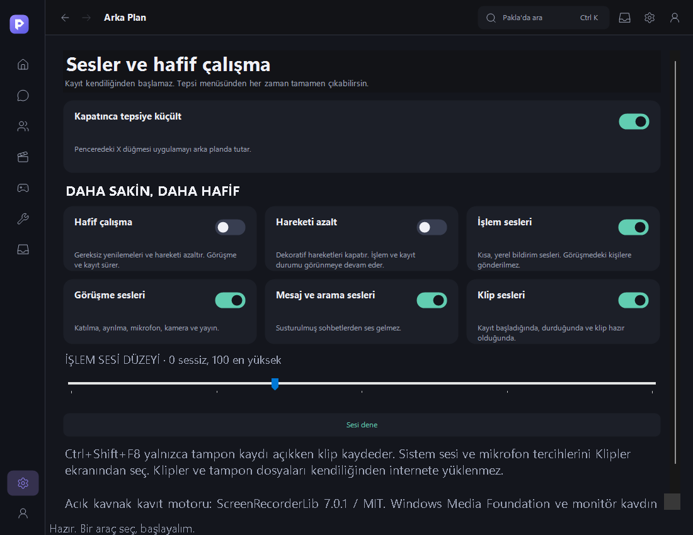

# Pakla Hub

Güncel sürüm: **4.21.1**.

[Windows için indir](https://raw.githubusercontent.com/nikolaspay/pakla-hub/main/distribution/PaklaHub-Kurulum.exe)

Mevcut kullanıcılar: Ayarlar → Güncellemeler → Güncelleme ara. Açılış denetimi yeni sürümü bildirir; yüklemeyi kullanıcı başlatır. Bot koruması etkindir; 4.20 ve daha eski sürümlerin yeniden giriş için güncellenmesi gerekir.

17 işlem sesi ve ayrı ses kontrolleri · 8 yayın kalitesi · Hafif çalışma ve azaltılmış hareket · DM/topluluk geçmişinde son mesaja git · Yerel klip oynatma ve orijinali koruyan kırpma · Sunucuda spam sınırları ve Turnstile.

[Doğrulama ve açık işler](distribution/4.21.1/QUALITY-421.md) · [SHA-256](distribution/4.21.1/SHA256SUMS.txt)

Ses/görüntü beta. TURN/SFU, ekran sesi, herkese açık bulut klip akışı ve Spotify OAuth tamamlanmadı. Tam DDoS veya sıfır veri sızıntısı garantisi verilmez. Kaynak kodu henüz yayımlanmadı.
